# Behavioral Microstructure Matching Engine

## ABOUT

An analytical research framework and visual execution suite engineered to evaluate high-frequency market microstructure dynamics, limit order book (LOB) queue priority, and behavioral liquidity matching matrices across volatile trading regimes.

This repository processes order flow telemetry to model how non-linear trader behavior, order cancellation spikes, and toxic liquidity impact fill probability, execution latency, and spread capture efficiency.

---

## Repository Directory Structure

```text
.
├── data_analysis/
│   ├── data_analysis_acs.py
│   ├── data_analysis_parquet.py
│   └── main.py
├── data_cleaning/
│   ├── acs/
│   │   ├── clean_data.py
│   │   ├── global_model.py
│   │   └── main.py
│   └── optiver/
│       └── data_clean_parquet.py
├── feature_engineering/
│   ├── behavioral_encode.py
│   ├── contract_architect.py
│   ├── main.py
│   ├── micro_encoder.py
│   ├── test_pipeline.py
│   └── visualize_contract.py
├── outcomes/
│   ├── graphs/
│   │   ├── bias_distribution.png
│   │   ├── bias_vs_hedge_ratio.png
│   │   ├── income_age_density.png
│   │   ├── income_distribution.png
│   │   ├── income_percentiles_by_age.png
│   │   ├── lorenz_curve.png
│   │   ├── matching_matrix.png
│   │   ├── median_income_by_age.png
│   │   ├── personalized_hedge_vs_volatility.png
│   │   ├── return_distribution.png
│   │   ├── return_vs_volatility.png
│   │   ├── volatility_clustering_time_series.png
│   │   ├── volatility_distribution.png
│   │   ├── volatility_vs_next_return.png
│   │   └── wap_time_series.png
│   └── models/
│       ├── behavioral_cols.json
│       ├── behavioral_norm_params.npz
│       └── global_behavioral_autoencoder.h5
├── .gitignore
├── README.md
└── requirements.txt
```

---

## Datasets & Data Pipeline

The matching engine integrates high-frequency limit order book (LOB) microdata alongside socio-demographic microdata to calibrate behavioral trauma decay and market microstructure volatility parameters.

### 1. High-Frequency Market Microstructure Data

* **Dataset:** [Optiver Realized Volatility Prediction](https://www.kaggle.com/competitions/optiver-realized-volatility-prediction/data)
* **Source:** Kaggle / Optiver (2021)
* **Direct Access:** [](https://www.kaggle.com/competitions/optiver-realized-volatility-prediction/data)
* **Scale:** 2.73 GB (229 files in Apache Parquet & CSV format)
* **Resolution:** 1-second interval order book snapshots and trade execution logs

#### Data Schema Breakdown
| File / Component | Key Fields | Description |
| :--- | :--- | :--- |
| `book_[train/test].parquet` | `stock_id`, `time_id`, `seconds_in_bucket`, `bid_price1/2`, `ask_price1/2`, `bid_size1/2`, `ask_size1/2` | Top-2 depth levels of the order book. Captures order book imbalance, bid-ask spread dynamics, and liquidity depth. |
| `trade_[train/test].parquet` | `stock_id`, `time_id`, `seconds_in_bucket`, `price`, `size`, `order_count` | Executed market transactions. Used to compute realized order flow toxicity and volume-weighted trade impact. |
| `train.csv` / `test.csv` | `stock_id`, `time_id`, `target` | Ground-truth 10-minute realized volatility target values: $\sigma = \sqrt{\sum_{t} r_t^2}$ |

**Citation**

```
@misc{optiver2021realizedvolatility,
  author    = {Meyer, Andrew and BerniceOptiver and CameronOptiver and IXAGPOPU and Liu, Jiashen and Pietrobon, Matteo and OptiverMerle and Dane, Sohier and Vallentine, Stefan},
  title     = {Optiver Realized Volatility Prediction},
  year      = {2021},
  publisher = {Kaggle},
  url       = {[https://www.kaggle.com/competitions/optiver-realized-volatility-prediction](https://www.kaggle.com/competitions/optiver-realized-volatility-prediction)}
}
```

### 2. Socio-Demographic & Household Microdata

* **Dataset:** [2015 American Community Survey (ACS) Public Use Microdata Sample](https://www.kaggle.com/datasets/census/2015-american-community-survey)
* **Source:** U.S. Census Bureau / Kaggle Data Hub
* **Direct Access:** [](https://www.kaggle.com/datasets/census/2015-american-community-survey)
* **License:** Public Domain (CC0)
* **Granularity:** Individual and household-level microdata

#### Data Schema Breakdown
| Feature Category | Key Fields | Description |
| :--- | :--- | :--- |
| **Cohort Weighting** | `PWGTP` | Person-level expansion weights applied for accurate population-level demographic synthesis. |
| **Economic Indicators** | Income, Employment, Demographics | Microdata variables used to model household financial cushions, liquidity constraints, and time-preference decay. |

**Citation**

```
@misc{us_census_acs_2015,
  author    = {U.S. Census Bureau},
  title     = {2015 American Community Survey Public Use Microdata Sample},
  year      = {2015},
  publisher = {Kaggle Data Hub},
  url       = {[https://www.kaggle.com/datasets/census/2015-american-community-survey](https://www.kaggle.com/datasets/census/2015-american-community-survey)}
}
```

---

## Microstructure & Matching Pipeline

### Data cleaning and Feature Engineering

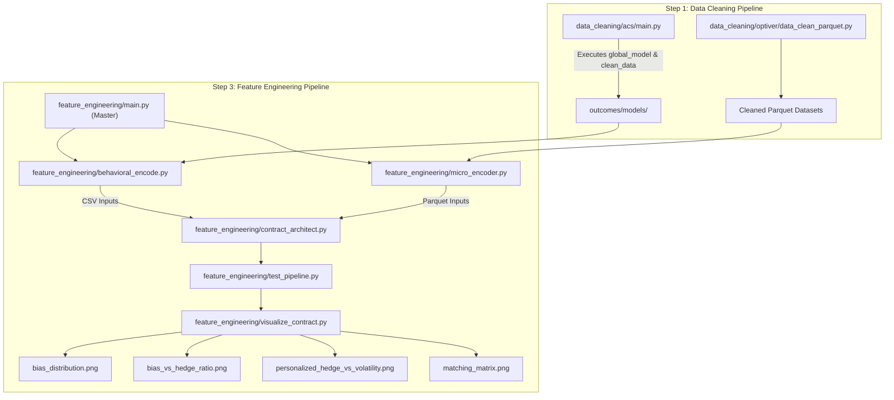

### Data Analysis Pipeline

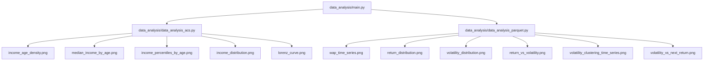

---

## Core Analytics & Research Focus

1. **Exploratory Data Analysis (`data_analysis/`):**
   
   - **ACS Demographic Analysis (`data_analysis_acs.py`):** Evaluates population income distributions, age densities, and economic inequality metrics, generating analytical exhibits such as `income_age_density.png`, `median_income_by_age.png`, `income_percentiles_by_age.png`, `income_distribution.png`, and `lorenz_curve.png`.
   
   - **Order Book Microstructure Analysis (`data_analysis_parquet.py`):** Processes high-frequency Optiver parquet data to study price dynamics and volatility patterns, producing charts including `wap_time_series.png`, `return_distribution.png`, `volatility_distribution.png`, `return_vs_volatility.png`, `volatility_clustering_time_series.png`, and `volatility_vs_next_return.png`.

2. **Microstructure Telemetry & Behavioral Bias Encoding (`feature_engineering/micro_encoder.py` & `feature_engineering/behavioral_encode.py`):**

   - **Microstructure Signals:** `micro_encoder.py` processes high-frequency order book data to compute Weighted Average Price (WAP), log-return realized volatility, and Order Flow Imbalance (OFI) to quantify net buying/selling pressure.
 
   - **Behavioral Profiling:** `behavioral_encode.py` parses demographic survey data (ACS) to derive a user `bias_score` based on historical economic exposure, classifying individual trader tendencies (e.g., Frugality vs. Overconfidence).

3. **Personalized Risk & Contract Architecture (`feature_engineering/contract_architect.py`):**
 
   - Combines microstructure market risk ($\text{Realized Volatility} \times (1 + \vert\text{OFI}\vert)$) with psychological bias scores:
   
     - **Overconfidence Buffer (`bias > 0.4`):** Dynamically scales hedge ratio by **1.5x** to cushion against over-leveraging.
     - **Frugality Efficiency (`bias < -0.4`):** Optimizes hedge ratio to **0.8x** for cost efficiency.
     - **Standard Alignment:** Preserves **1.0x** base market risk hedge ratio.

5. **Visual Execution Diagnostics & Sensitivity Heatmaps (`feature_engineering/visualize_contract.py`):**

   - Generates core contract-level research graphs saved to `outcomes/graphs/`:
   
     - `bias_distribution.png`: Population bias distribution alongside market volatility sensitivity bands.
     - `bias_vs_hedge_ratio.png`: User demographic/bias metrics versus final hedge ratio allocations.
     - `hedge_vs_volatility.png`: Dynamic contract hedge adjustments across varying volatility regimes.
     - `matching_matrix.png`: 2D heatmap matrix evaluating target hedge ratios across market micro-volatility and user behavioral bias. 
---

## Installation & Environment Setup

1. **Clone the Repository**

Clone the repository and navigate into the project directory:

    `git clone [https://github.com/pikum06/behavioral-microstructure-matching-engine-demo.git](https://github.com/pikum06/behavioral-microstructure-matching-engine-demo.git)`

2. **Create Virtual Environment**

    `python3 -m venv venv`

3. **Install Dependencies**
    `pip install -r requirements.txt`

## Execution Sequence

To run the complete pipeline from scratch, execute the steps in the following strict sequential order:

### Step 1: Data Cleaning

Run the data cleaning pipelines to preprocess raw demographic and market data:

1. Navigate to `data_cleaning/acs/` and run `main.py` (which automatically executes `global_model.py` and `clean_data.py`): `python data_cleaning/acs/main.py`

Run the Optiver parquet data cleaning script:

2. Navigate to `data_cleaning/optiver/`and run `python data_cleaning/optiver/data_clean_parquet.py`

### Step 2: Data Analysis

Run exploratory data analysis across the cleaned datasets:

1. Execute the data analysis master script `(data_analysis/main.py)`, which runs `data_analysis_acs.py` and `data_analysis_parquet.py`: `python data_analysis/main.py`

### Step 3: Feature Engineering

Run the feature engineering pipeline to generate behavioral encoders, market telemetry, risk contracts, and visual exhibits:

1. Execute the feature engineering master script `(feature_engineering/main.py)`, which sequentially runs `behavioral_encode.py`, `micro_encoder.py`, `contract_architect.py`, `test_pipeline.py`, and `visualize_contract.py`: `python feature_engineering/main.py`

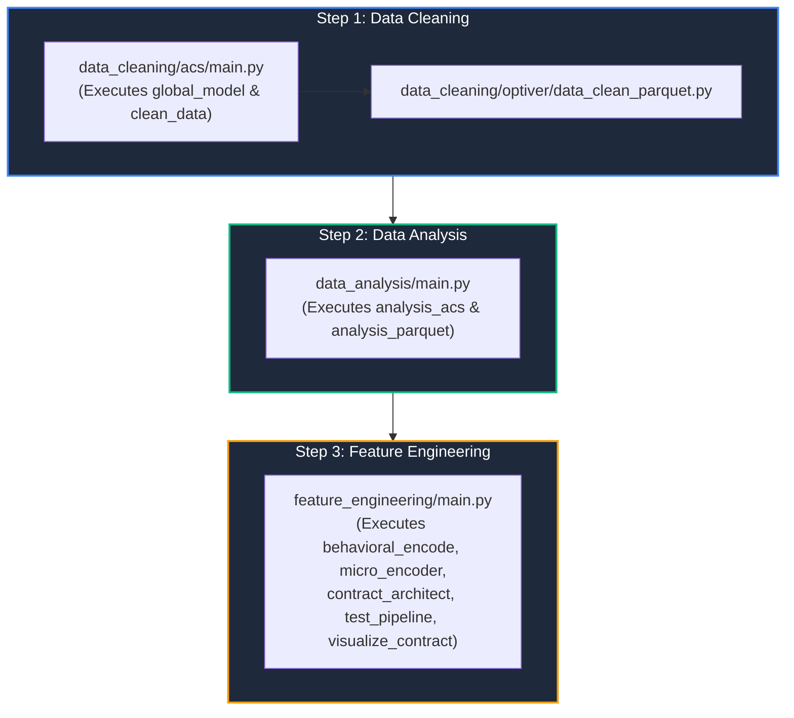
---

## Visual Outcomes

1. **bias_distribution.png**

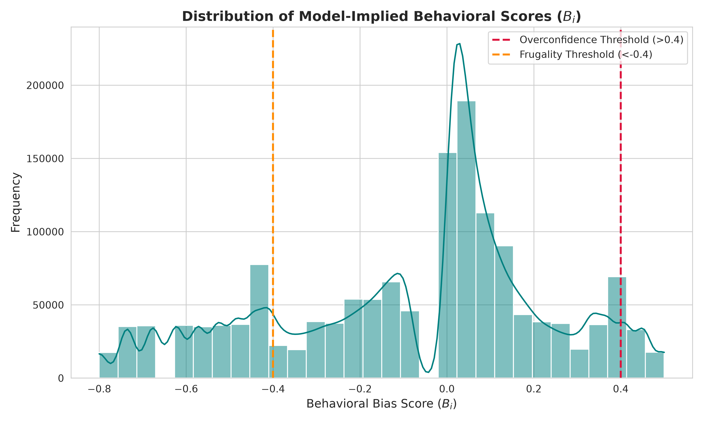

The figure above illustrates the population-wide frequency distribution and Kernel Density Estimation (KDE) curve of model-implied behavioral bias scores ($B_i$) derived from demographic and macroeconomic exposure modeling across the dataset. The vertical dashed lines delineate critical policy boundaries: the orange dashed line indicates the Frugality Threshold ($B_i < -0.4$), while the red dashed line marks the Overconfidence Threshold ($B_i > 0.4$). This distribution underpins the multi-tier risk adjustment engine, ensuring that individualized contract parameters dynamically scale according to population-level psychological skew.

2. **bias_vs_hedge_ratio.png**

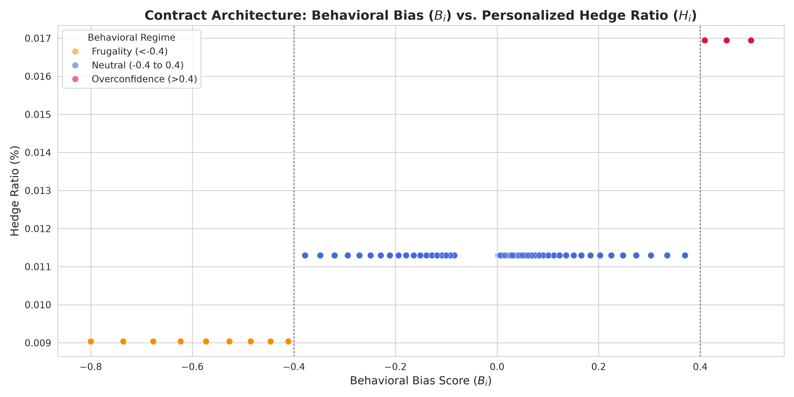

The above scatter plot maps individual Behavioral Bias Scores ($B_i$) against the resulting Personalized Hedge Ratio ($H_i$) across three distinct behavioral regimes. Color-coded markers distinguish Frugality ($B_i < -0.4$, orange), Standard Risk Alignment ($ -0.4 \le B_i \le 0.4$, blue), and Overconfidence ($B_i > 0.4$, red) regimes, bounded by vertical dotted threshold lines. The step-function response demonstrates how institutional hedging multipliers are structurally adjusted to penalize overconfidence while rewarding conservative allocations.

3. **income_age_density.png**

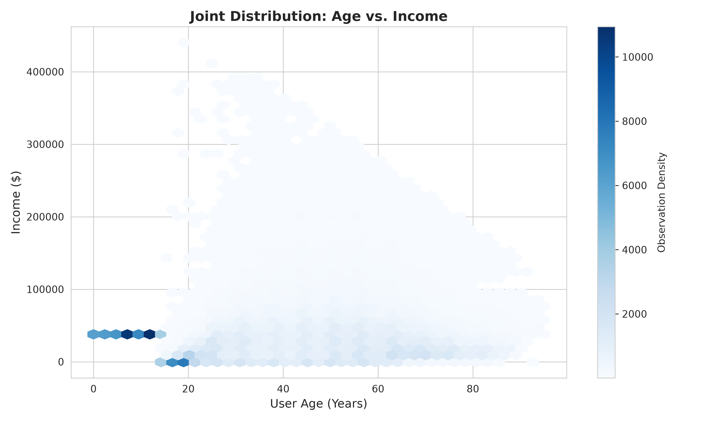

The hexbin joint density plot above visualizes the bivariative distribution of User Age against Income across the demographic dataset. The color bar intensity represents observation density, highlighting major lifecycle earning clusters and income concentrations across age cohorts. This empirical mapping verifies how macroeconomic inputs from the American Community Survey correlate with earning lifecycles prior to behavioral indexing.

4. **income_distribution.png**

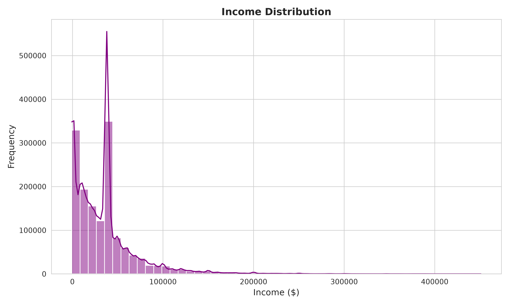

The figure above displays the overall frequency distribution and kernel density curve of user income across the cleaned dataset. Characterized by a strong positive skew, the distribution captures heavy clustering in lower-to-middle income brackets with a long tail extending toward high-net-worth brackets. This macro-level income dispersion provides the baseline economic heterogeneity necessary for evaluating financial product sensitivity across varying wealth tiers.

5. **income_percentiles_by_age.jpg**

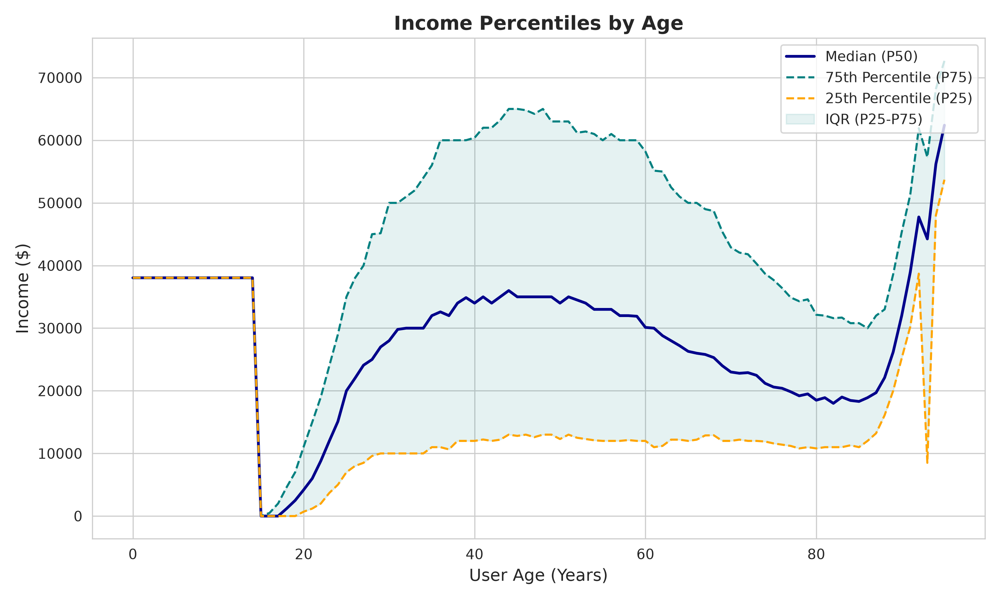

The figure above illustrates the lifecycle trajectory of income percentiles across user age cohorts, plotting the Median (P50, solid dark blue line) alongside the 75th (P75, dashed teal line) and 25th (P25, dashed orange line) percentiles. The shaded interquartile range (IQR) highlights the widening dispersion of earnings during prime working years before tapering into retirement. This lifecycle economic profiling provides structural context for evaluating how financial risk tolerance and wealth accumulation evolve across different demographic stages.

6. **lorenz_curve.png**

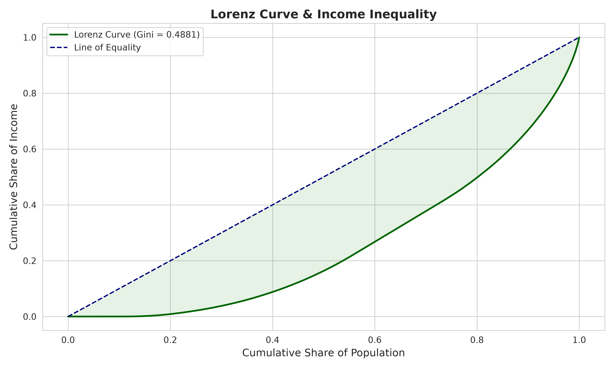

This supplementary Lorenz Curve and inequality visualization (Gini = $0.4881$) provides a comparative distributional view of cumulative population shares against cumulative income shares. It serves as an auxiliary diagnostic tool to validate income skewness and structural inequality parameters prior to integrating macro-demographic data into the downstream financial architecture.

7. **matching_matrix.jpg**

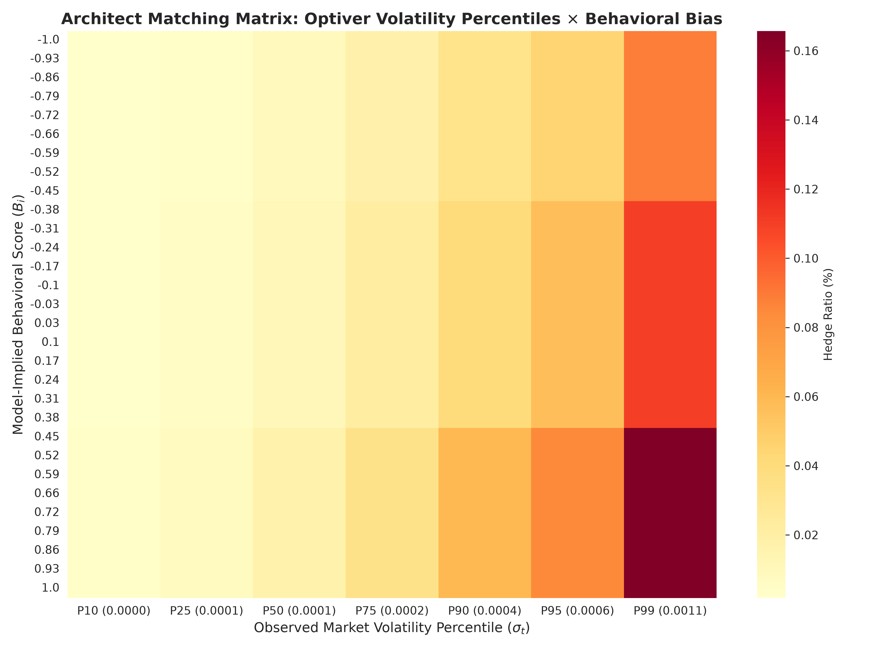

The figure above presents the Architect Matching Matrix, a high-precision heatmap intersecting Model-Implied Behavioral Bias Scores ($B_i$) on the vertical axis with Optiver Observed Market Volatility Percentiles ($\sigma_t$) on the horizontal axis. The color gradient represents the resulting Hedge Ratio (%), identifying critical high-risk zones where extreme behavioral skews meet elevated market volatility. This matrix serves as the core proof of efficacy for protocol risk management, enabling decentralized banking systems to preemptively calibrate protection levels before liquidation events occur.

8. **median_income_by_age.png**

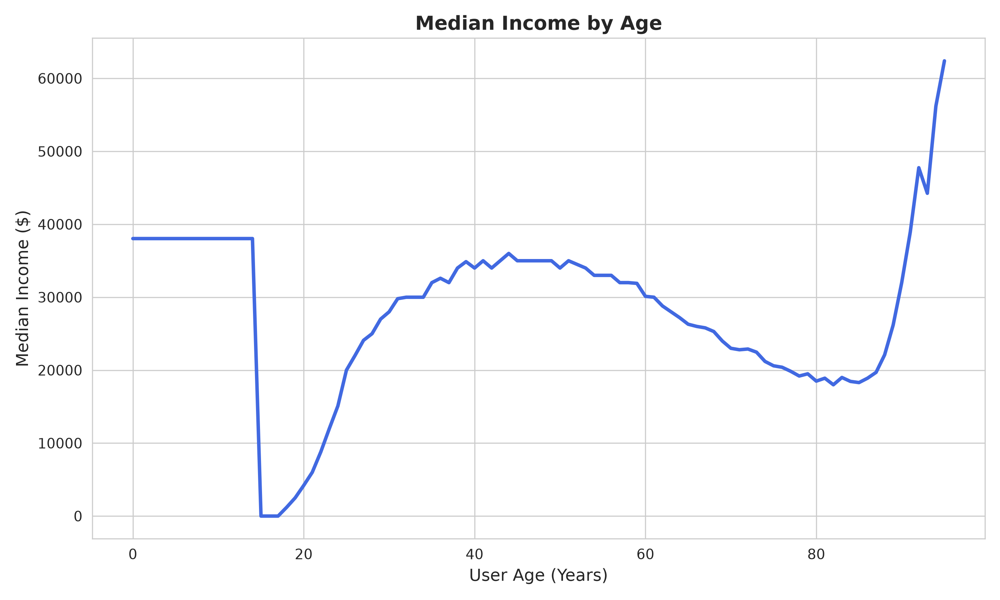

The graph above charts the lifecycle trajectory of Median Income ($) against User Age (Years) across the demographic dataset. The blue curve illustrates the median earning profile from early years through prime working age and retirement, capturing distinct career-earning plateaus and late-life economic shifts. This baseline median trajectory provides essential macro-demographic context for modeling personalized financial risk tolerances across age cohorts.

9. **personalized_hedge_vs_volatility.png**

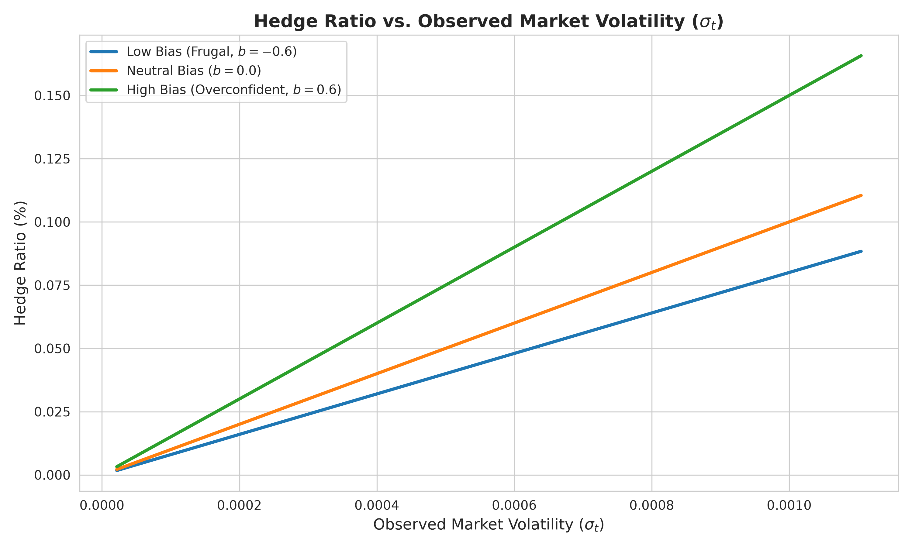

The figure above plots the dynamic scaling of the Personalized Hedge Ratio (%) against Observed Market Volatility ($\sigma_t$) across three distinct psychological bias profiles: Low Bias / Frugal ($b = -0.6$, blue line), Neutral Bias ($b = 0.0$, orange line), and High Bias / Overconfident ($b = 0.6$, green line). The upward-sloping trajectories demonstrate how the Behavioral-Microstructure Matching Engine scales protection levels relative to market stress, enforcing steeper hedging requirements for overconfident risk profiles during high-volatility liquidity shocks.

10. **return_distribution.png**

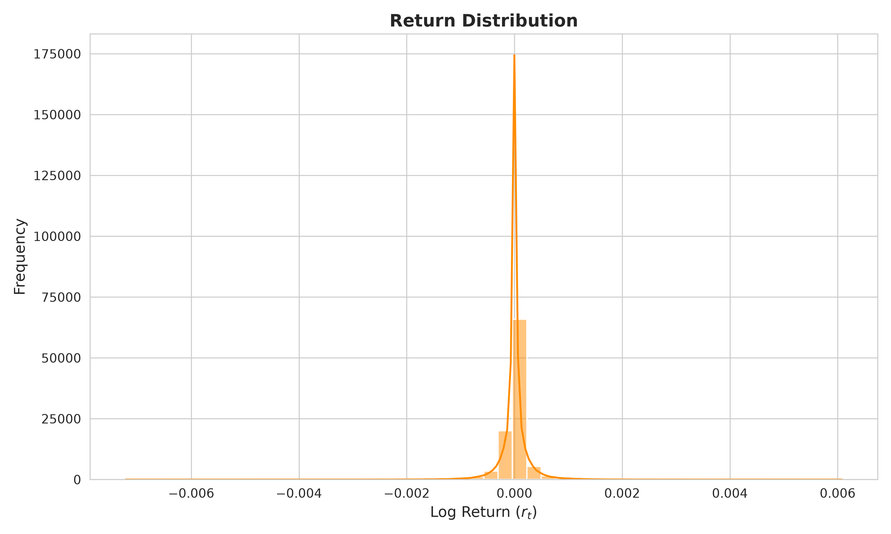

The figure above displays the empirical frequency histogram and fitted probability density curve of high-frequency Log Returns ($r_t$) derived from the Optiver market microstructure dataset. Exhibiting a sharp leptokurtic peak and fat tails centered tightly around zero, this distribution captures the characteristic volatility clustering and non-Gaussian risk profiles inherent in high-frequency limit order book data, providing the foundational variance inputs for the matching engine.

11. **return_vs_volatility.jpg**

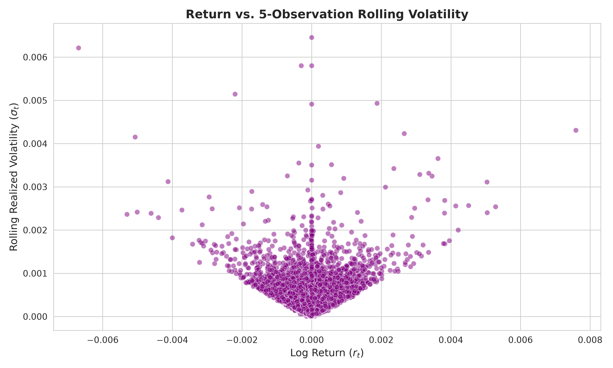

The scatter plot above maps high-frequency Log Returns ($r_t$) against 5-observation Rolling Realized Volatility ($\sigma_t$) derived from the Optiver limit order book data. The characteristic funnel-shaped dispersion illustrates the structural relationship between price changes and variance clustering, confirming how high-frequency volatility expands symmetrically as returns diverge from the zero-mean baseline.

12. **volatility_clustering_time_series.jpg**

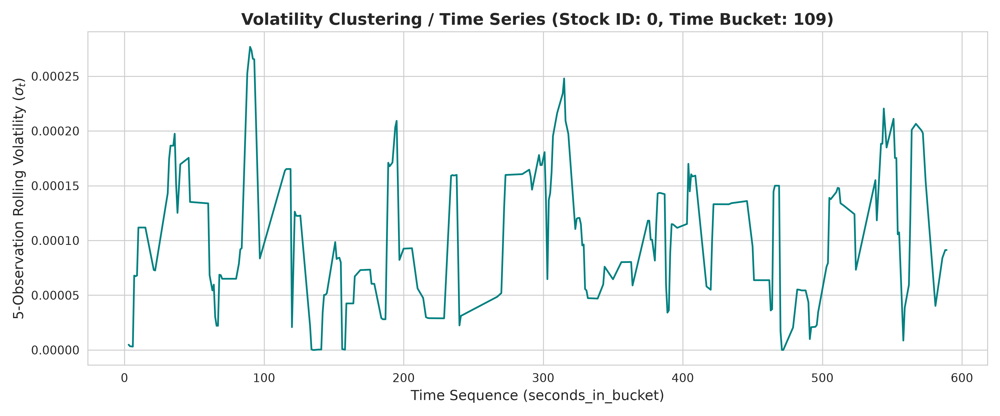

The figure above displays the time-series evolution of 5-observation Rolling Realized Volatility ($\sigma_t$) across the time sequence (`seconds_in_bucket`) for Stock ID: 0 within Time Bucket: 109. The teal trajectory highlights localized volatility clustering, characterized by alternating periods of quiescence and sharp variance spikes. This granular time-series trace serves as the baseline input for evaluating how high-frequency market stress events propagate into the decentralized matching engine.

13. **volatility_distribution.png**

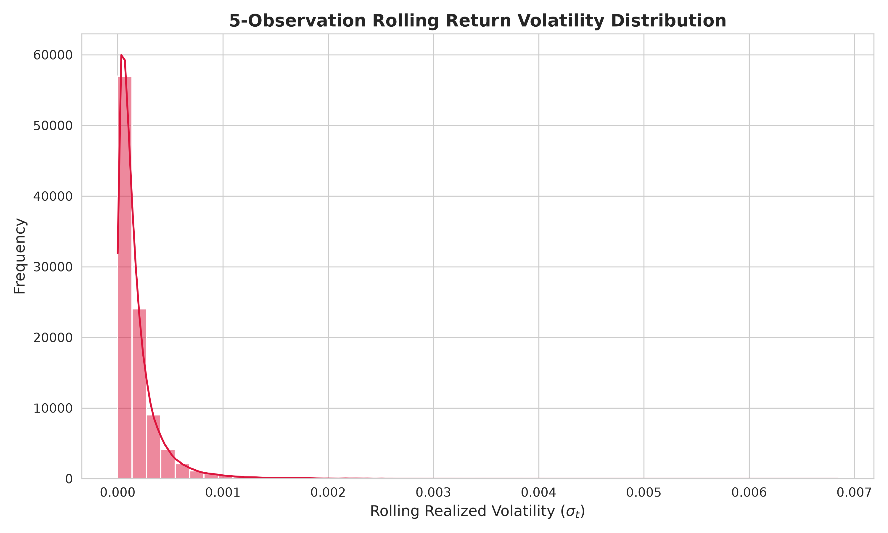

The figure above illustrates the frequency histogram and kernel density estimation curve of the 5-Observation Rolling Realized Volatility ($\sigma_t$) across the dataset. Characterized by a pronounced right skew and a dense concentration of observations near zero with a long tail extending toward higher variance levels, this distribution captures the baseline volatility profile of high-frequency limit order book returns, establishing the foundational dispersion parameters for risk-adjusted contract pricing.

14. **volatility_vs_next_return.jpg**

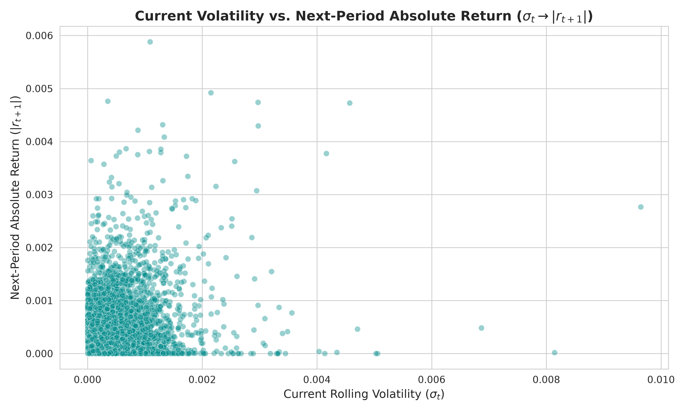

The scatter plot above maps Current Rolling Volatility ($\sigma_t$) on the horizontal axis against Next-Period Absolute Return ($|r_{t+1}|$) on the vertical axis, utilizing high-frequency Optiver market microstructure data[cite: 14]. The dense clustering near the origin alongside dispersed tail observations captures the predictive temporal dependency between current variance states and subsequent absolute price movements, validating the volatility persistence parameters integrated into the decentralized matching engine.

15. **wap_time_series.png**

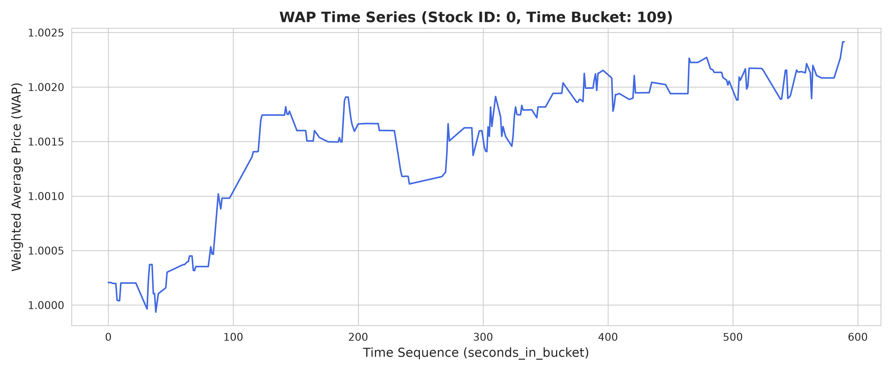

The figure above illustrates the high-frequency intra-bucket time-series evolution of the Weighted Average Price (WAP) across the time sequence (`seconds_in_bucket`) for Stock ID: 0 within Time Bucket: 109[cite: 14]. The blue trajectory captures intraday price discovery dynamics, micro-trends, and liquidity shifts, providing the foundational price series required to compute log returns and realized volatility metrics for the downstream decentralized matching engine.
