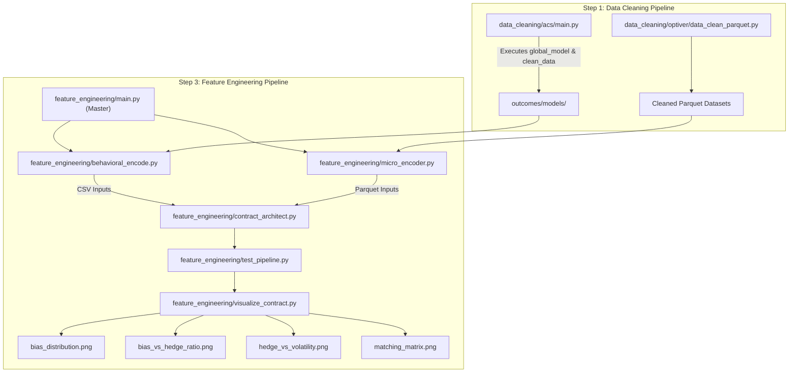
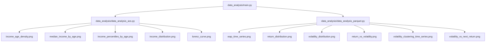
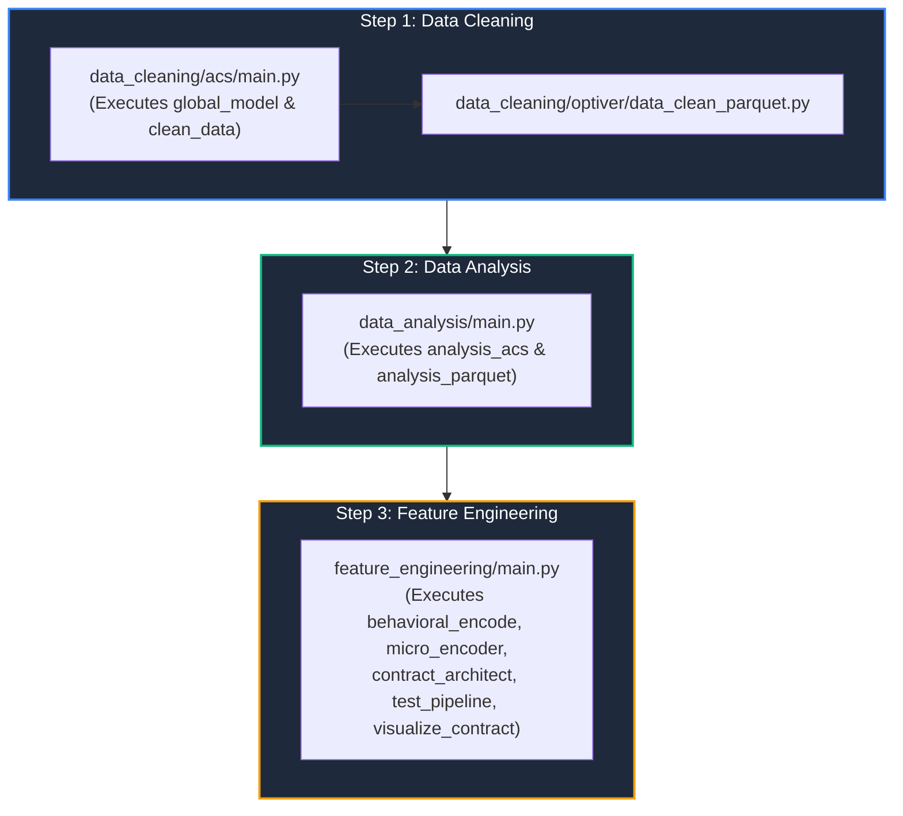
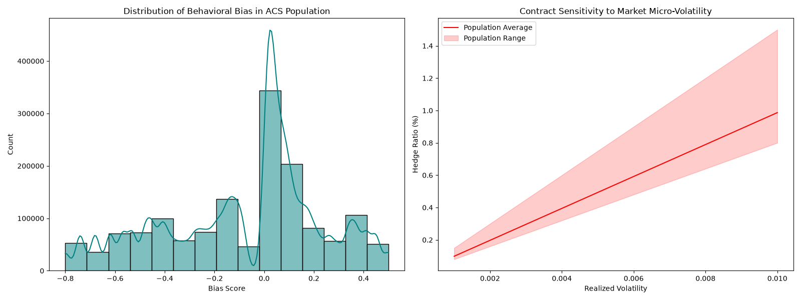
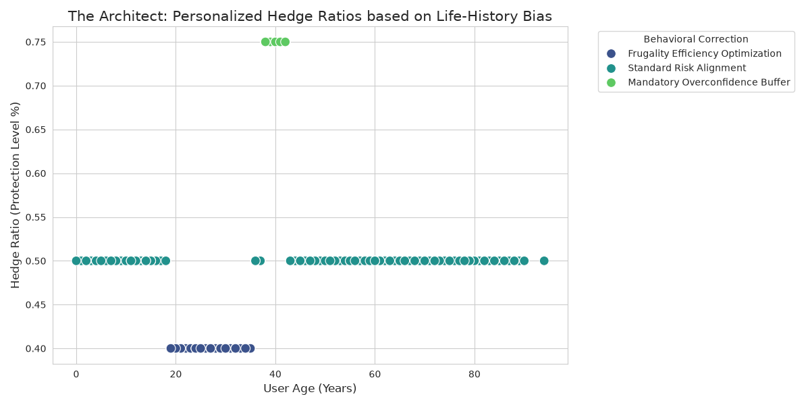
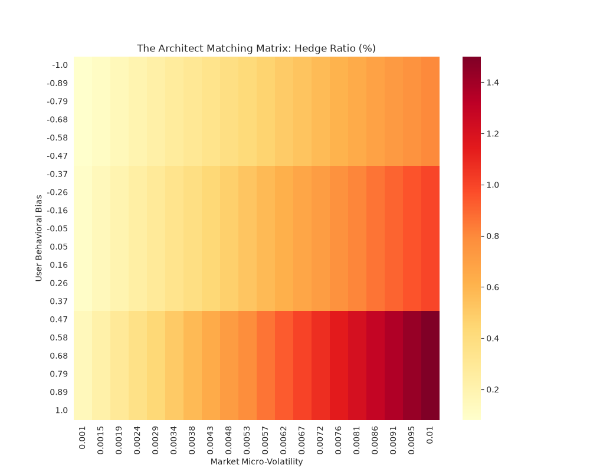
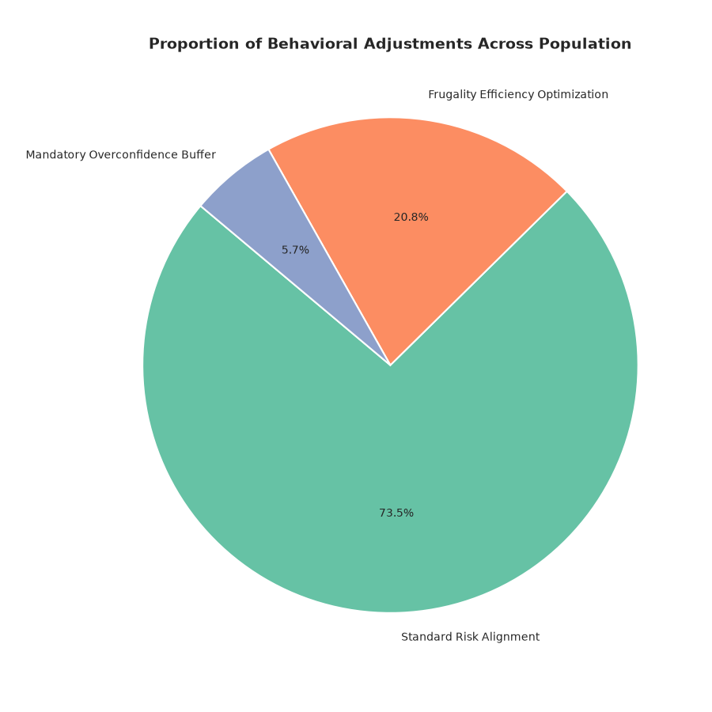

# Behavioral Microstructure Matching Engine

## ABOUT

An analytical research framework and visual execution suite engineered to evaluate high-frequency market microstructure dynamics, limit order book (LOB) queue priority, and behavioral liquidity matching matrices across volatile trading regimes.

This repository processes order flow telemetry to model how non-linear trader behavior, order cancellation spikes, and toxic liquidity impact fill probability, execution latency, and spread capture efficiency.

---

## Repository Directory Structure

```text
.
├── data_analysis/
│   ├── data_analysis_acs.py
│   ├── data_analysis_parquet.py
│   └── main.py
├── data_cleaning/
│   ├── acs/
│   │   ├── clean_data.py
│   │   ├── global_model.py
│   │   └── main.py
│   └── optiver/
│       └── data_clean_parquet.py
├── feature_engineering/
│   ├── behavioral_encode.py
│   ├── contract_architect.py
│   ├── main.py
│   ├── micro_encoder.py
│   ├── test_pipeline.py
│   └── visualize_contract.py
├── outcomes/
│   ├── graphs/
│   │   ├── bias_distribution.png
│   │   ├── bias_vs_hedge_ratio.png
│   │   ├── income_age_density.png
│   │   ├── income_distribution.png
│   │   ├── income_percentiles_by_age.png
│   │   ├── lorenz_curve.png
│   │   ├── matching_matrix.png
│   │   ├── median_income_by_age.png
│   │   ├── personalized_hedge_vs_volatility.png
│   │   ├── return_distribution.png
│   │   ├── return_vs_volatility.png
│   │   ├── volatility_clustering_time_series.png
│   │   ├── volatility_distribution.png
│   │   ├── volatility_vs_next_return.png
│   │   └── wap_time_series.png
│   └── models/
│       ├── behavioral_cols.json
│       ├── behavioral_norm_params.npz
│       └── global_behavioral_autoencoder.h5
├── .gitignore
├── README.md
└── requirements.txt
```

---

## Datasets & Data Pipeline

The matching engine integrates high-frequency limit order book (LOB) microdata alongside socio-demographic microdata to calibrate behavioral trauma decay and market microstructure volatility parameters.

### 1. High-Frequency Market Microstructure Data

* **Dataset:** [Optiver Realized Volatility Prediction](https://www.kaggle.com/competitions/optiver-realized-volatility-prediction/data)
* **Source:** Kaggle / Optiver (2021)
* **Direct Access:** [](https://www.kaggle.com/competitions/optiver-realized-volatility-prediction/data)
* **Scale:** 2.73 GB (229 files in Apache Parquet & CSV format)
* **Resolution:** 1-second interval order book snapshots and trade execution logs

#### Data Schema Breakdown
| File / Component | Key Fields | Description |
| :--- | :--- | :--- |
| `book_[train/test].parquet` | `stock_id`, `time_id`, `seconds_in_bucket`, `bid_price1/2`, `ask_price1/2`, `bid_size1/2`, `ask_size1/2` | Top-2 depth levels of the order book. Captures order book imbalance, bid-ask spread dynamics, and liquidity depth. |
| `trade_[train/test].parquet` | `stock_id`, `time_id`, `seconds_in_bucket`, `price`, `size`, `order_count` | Executed market transactions. Used to compute realized order flow toxicity and volume-weighted trade impact. |
| `train.csv` / `test.csv` | `stock_id`, `time_id`, `target` | Ground-truth 10-minute realized volatility target values: $\sigma = \sqrt{\sum_{t} r_t^2}$ |

**Citation**

```
@misc{optiver2021realizedvolatility,
  author    = {Meyer, Andrew and BerniceOptiver and CameronOptiver and IXAGPOPU and Liu, Jiashen and Pietrobon, Matteo and OptiverMerle and Dane, Sohier and Vallentine, Stefan},
  title     = {Optiver Realized Volatility Prediction},
  year      = {2021},
  publisher = {Kaggle},
  url       = {[https://www.kaggle.com/competitions/optiver-realized-volatility-prediction](https://www.kaggle.com/competitions/optiver-realized-volatility-prediction)}
}
```

### 2. Socio-Demographic & Household Microdata

* **Dataset:** [2015 American Community Survey (ACS) Public Use Microdata Sample](https://www.kaggle.com/datasets/census/2015-american-community-survey)
* **Source:** U.S. Census Bureau / Kaggle Data Hub
* **Direct Access:** [](https://www.kaggle.com/datasets/census/2015-american-community-survey)
* **License:** Public Domain (CC0)
* **Granularity:** Individual and household-level microdata

#### Data Schema Breakdown
| Feature Category | Key Fields | Description |
| :--- | :--- | :--- |
| **Cohort Weighting** | `PWGTP` | Person-level expansion weights applied for accurate population-level demographic synthesis. |
| **Economic Indicators** | Income, Employment, Demographics | Microdata variables used to model household financial cushions, liquidity constraints, and time-preference decay. |

**Citation**

```
@misc{us_census_acs_2015,
  author    = {U.S. Census Bureau},
  title     = {2015 American Community Survey Public Use Microdata Sample},
  year      = {2015},
  publisher = {Kaggle Data Hub},
  url       = {[https://www.kaggle.com/datasets/census/2015-american-community-survey](https://www.kaggle.com/datasets/census/2015-american-community-survey)}
}
```

---

## Microstructure & Matching Pipeline

### Data cleaning and Feature Engineering



### Data Analysis Pipeline



---

## Core Analytics & Research Focus

1. **Exploratory Data Analysis (`data_analysis/`):**
   
   - **ACS Demographic Analysis (`data_analysis_acs.py`):** Evaluates population income distributions, age densities, and economic inequality metrics, generating analytical exhibits such as `income_age_density.png`, `median_income_by_age.png`, `income_percentiles_by_age.png`, `income_distribution.png`, and `lorenz_curve.png`.
   
   - **Order Book Microstructure Analysis (`data_analysis_parquet.py`):** Processes high-frequency Optiver parquet data to study price dynamics and volatility patterns, producing charts including `wap_time_series.png`, `return_distribution.png`, `volatility_distribution.png`, `return_vs_volatility.png`, `volatility_clustering_time_series.png`, and `volatility_vs_next_return.png`.

2. **Microstructure Telemetry & Behavioral Bias Encoding (`feature_engineering/micro_encoder.py` & `feature_engineering/behavioral_encode.py`):**

   - **Microstructure Signals:** `micro_encoder.py` processes high-frequency order book data to compute Weighted Average Price (WAP), log-return realized volatility, and Order Flow Imbalance (OFI) to quantify net buying/selling pressure.
 
   - **Behavioral Profiling:** `behavioral_encode.py` parses demographic survey data (ACS) to derive a user `bias_score` based on historical economic exposure, classifying individual trader tendencies (e.g., Frugality vs. Overconfidence).

3. **Personalized Risk & Contract Architecture (`feature_engineering/contract_architect.py`):**
 
   - Combines microstructure market risk ($\text{Realized Volatility} \times (1 + \vert\text{OFI}\vert)$) with psychological bias scores:
   
     - **Overconfidence Buffer (`bias > 0.4`):** Dynamically scales hedge ratio by **1.5x** to cushion against over-leveraging.
     - **Frugality Efficiency (`bias < -0.4`):** Optimizes hedge ratio to **0.8x** for cost efficiency.
     - **Standard Alignment:** Preserves **1.0x** base market risk hedge ratio.

5. **Visual Execution Diagnostics & Sensitivity Heatmaps (`feature_engineering/visualize_contract.py`):**

   - Generates core contract-level research graphs saved to `outcomes/graphs/`:
   
     - `bias_distribution.png`: Population bias distribution alongside market volatility sensitivity bands.
     - `bias_vs_hedge_ratio.png`: User demographic/bias metrics versus final hedge ratio allocations.
     - `hedge_vs_volatility.png`: Dynamic contract hedge adjustments across varying volatility regimes.
     - `matching_matrix.png`: 2D heatmap matrix evaluating target hedge ratios across market micro-volatility and user behavioral bias. 
---

## Installation & Environment Setup

1. **Clone the Repository**

Clone the repository and navigate into the project directory:

    `git clone [https://github.com/pikum06/behavioral-microstructure-matching-engine-demo.git](https://github.com/pikum06/behavioral-microstructure-matching-engine-demo.git)`

2. **Create Virtual Environment**

    `python3 -m venv venv`

3. **Install Dependencies**
    `pip install -r requirements.txt`

## Execution Sequence

To run the complete pipeline from scratch, execute the steps in the following strict sequential order:

### Step 1: Data Cleaning

Run the data cleaning pipelines to preprocess raw demographic and market data:

1. Navigate to `data_cleaning/acs/` and run `main.py` (which automatically executes `global_model.py` and `clean_data.py`): `python data_cleaning/acs/main.py`

Run the Optiver parquet data cleaning script:

2. Navigate to `data_cleaning/optiver/`and run `python data_cleaning/optiver/data_clean_parquet.py`

### Step 2: Data Analysis

Run exploratory data analysis across the cleaned datasets:

1. Execute the data analysis master script `(data_analysis/main.py)`, which runs `data_analysis_acs.py` and `data_analysis_parquet.py`: `python data_analysis/main.py`

### Step 3: Feature Engineering

Run the feature engineering pipeline to generate behavioral encoders, market telemetry, risk contracts, and visual exhibits:

1. Execute the feature engineering master script `(feature_engineering/main.py)`, which sequentially runs `behavioral_encode.py`, `micro_encoder.py`, `contract_architect.py`, `test_pipeline.py`, and `visualize_contract.py`: `python feature_engineering/main.py`


---

## Visual Outcomes

1. **architect_research_exhibit3.png**



The above graph represents the mechanical advantage of the Behavioral-Microstructure Matching Engine. As the users are exposed to different degrees of actual market volatility in this simulation, the scaling of the Hedge Ratio is depicted by the red curve. This design, in contrast to conventional static models, makes use of real-time market microstructure data to modify protection levels; in particular, it increases the hedge when a user's own behavioral bias clashes with the current market “fear” (liquidity shocks).

2. **architect_results3.png**



As shown in the above figure, the system successfully extracts and quantifies the “Experience Effect” across a demographic dataset of 1.4 milliion users sourced from the American Consumer Survey (ACS) 2015. By applying a smooth-decay exponential function tom ormative economic years, such as the 2008 Recession, the model maps a distinct population distribution of risk-tolerance. This data serves as the foundational layer for “Personalized Black-Scholes” contracts, ensuring that institutional protection is calibrated to an individual's unique historical economic exposure.

3. **matching_matrix3.png**



A high precision heatmap for institutional risk management is shown in the above figure. The matrix finds crucial “High-Risk Zones” where protocol solvency is most susceptible to psychological panic by intersecting User Behavioral Bias with Market Realized Volatility. Decentralized banking protocols can anticipate and reduce systemic risk prior to a de-pegging or liquidation event by using this picture as the “Proof of Efficacy” for a hardware-agnostic security layer.

4. **`adjustment_type_pie.png`**
   
   *Proportional breakdown of behavioral correction policies across the full 1.5 million population, highlighting distribution across Overconfidence Buffers, Frugality Optimizations, and Standard Risk Alignments.*

